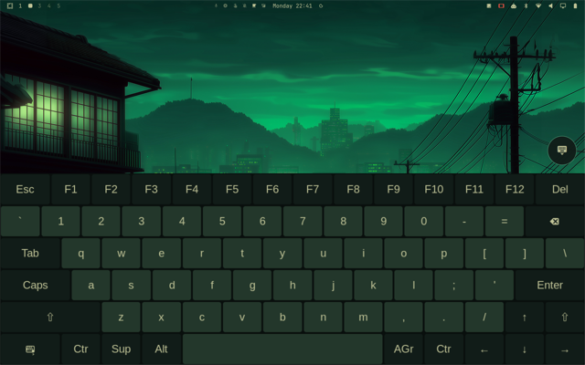
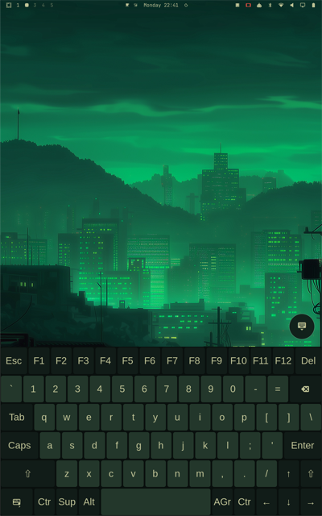
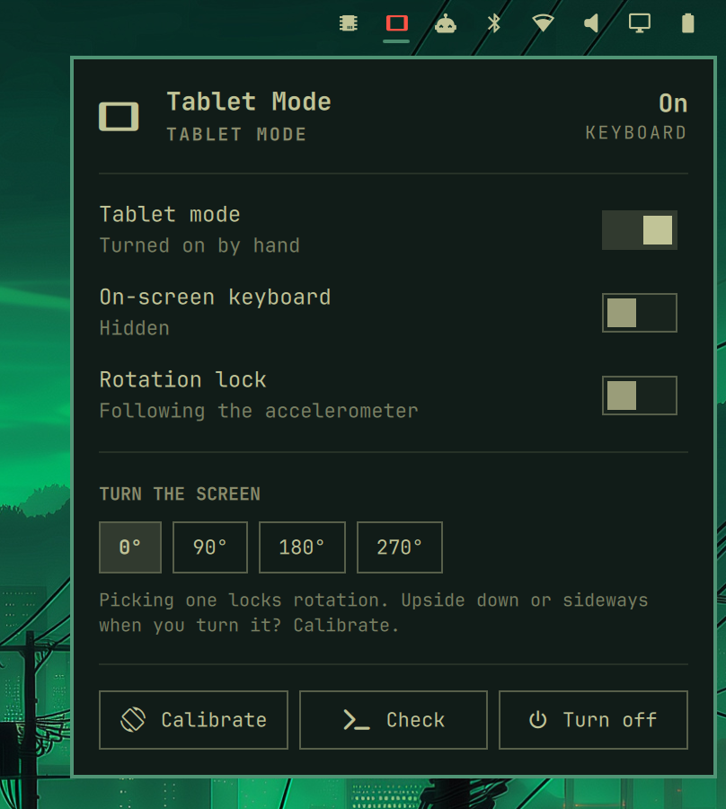

# Tablet Mode for Omarchy

Take the keyboard off a detachable and Omarchy turns into a tablet. The screen follows the accelerometer, an on-screen keyboard appears, and window gaps and border grab areas get bigger for fingers. Put the keyboard back and it's a laptop again. One switch turns the whole plugin off and returns the system to plain Omarchy.

**Tested so far on one machine only: ASUS ROG Flow Z13 (GZ302EA), Omarchy 4.0.5 (Qt 6.12), Hyprland 0.56.2.** Other detachables and convertibles should work after setting their keyboard's USB id and running `calibrate`.

<p align="center">
  
  
</p>

<p align="center"><em>Tablet mode on the Z13 with the Osaka Jade theme. The on-screen keyboard, the floating ⌨ button and the bar follow the current Omarchy theme.</em></p>

## What it does

| | Keyboard detached (or toggled on) | Keyboard attached (or toggled off) |
|---|---|---|
| Rotation | Follows the accelerometer, touchscreen and pen included | Landscape |
| On-screen keyboard | Shown: a US desktop layout ([wvkbd](https://git.sr.ht/~proycon/wvkbd), themed to match), plus a floating ⌨ button to show or hide it | Hidden |
| Touch tweaks | Wider gaps; borders easier to grab | Hyprland's own values back |
| Notification | "Tablet mode" | "Laptop mode" |

External monitors are never rotated. Your `monitors.lua` is never edited: every change is applied live, re-applied after a config reload, and undone when the plugin stops.

## Requirements

- Omarchy 4 (Hyprland with Lua config).
- An accelerometer that iio-sensor-proxy can read (`ls /sys/bus/iio/devices/*/in_accel_x_raw`).
- For automatic tablet mode, a keyboard that appears and disappears as a USB device. The Z13's is `0b05:1a30`.
- Tools it uses, all part of a standard Omarchy install: `jq`, `socat`, `python3` (to edit the menu file safely) and `base-devel` (to build the on-screen keyboard). Setup adds `iio-sensor-proxy` and builds `wvkbd-deskus`.

## Install

```bash
omarchy plugin add https://github.com/AlanRoman117/omarchy-tablet-mode-asus-rog-flow-z13.git --enable
```

Then click the dimmed laptop icon in the bar. The card walks you through setup:

1. **Set up** opens a terminal and asks for your password. It installs `iio-sensor-proxy` from the Arch repos. Then it builds the on-screen keyboard (`packaging/wvkbd-deskus`): wvkbd 0.20 from upstream with three small patches.
   - A US desktop layout: upstream's desktop layout with the Compose key taken off the home row.
   - Held keys stay down until your finger lifts, and are released if the touch is cancelled or the keyboard hides.
   - An `--output` option, so the keyboard stays on the laptop screen when you're docked.

   It shows you every file of the recipe and asks before building (even with `--yes`). The build runs from that same private copy (plain files only, so nothing can change after you've read it), and makepkg checks the upstream source against its pinned checksum.
2. **Not a Z13?** Before finishing setup, put your detachable keyboard's USB id in `~/.config/omarchy/tablet-mode.conf` (`keyboard=vendor:product`, from `lsusb`), or `keyboard=none` to switch modes by hand only. A keyboard id that has never been present on your machine doesn't switch modes, so the default can't put a different laptop into tablet mode; `tablet-mode doctor` says when that's the case.
3. **Finish setup** starts the service, adds the menu entries and installs a theme hook.
4. **Calibrate** only if the screen turns the wrong way (on the card, or `tablet-mode calibrate`). It needs two poses, and you confirm the picture is the right way up. The Z13 doesn't need it.

Adding a plugin to Omarchy only copies its files; installing packages needs your password, which is why setup is a step you start yourself. From a terminal, the same steps are `tablet-mode install`, `tablet-mode enable` and `tablet-mode calibrate`. After `enable`, `tablet-mode` is on your PATH through `~/.local/bin`.

## The card



Tap the bar icon:

- **Tablet mode**, **On-screen keyboard** and **Rotation lock** switches.
- **Turn the screen**: 0°, 90°, 180° or 270°. Picking one locks rotation.
- **Calibrate**, **Check** (runs `doctor`) and **Turn off**.

The same switches are in the Omarchy menu under **Trigger → Toggle**.

<br clear="right">

## Commands

```bash
tablet-mode status            # what's going on (--json for scripts)
tablet-mode on|off|toggle     # by hand, until the keyboard is next attached or detached
tablet-mode rotate 90         # normal|90|180|270, and locks rotation
tablet-mode lock toggle       # rotation lock
tablet-mode osk toggle        # on-screen keyboard: show|hide|toggle
tablet-mode doctor            # check the setup
```

## Turning it off: plain Omarchy

```bash
tablet-mode disable           # everything off, every change undone, nothing starts at login
tablet-mode disable --full    # also removes the menu entries, the theme hook and the bar icon
tablet-mode doctor --full     # proves it: no processes, no rotation, no tweaks, no entries
tablet-mode enable            # all back
```

`disable` keeps the bar icon, dimmed, with a **Turn on** button. A menu entry (**Tablet Mode Plugin**) does the same. Packages stay installed and idle: iio-sensor-proxy only starts when something asks for the accelerometer, and wvkbd doesn't run. `tablet-mode uninstall --packages` also removes `wvkbd-deskus`, the keyboard the plugin built; it leaves `iio-sensor-proxy` and the AUR `wvkbd`, which other things may use, and says how to remove them.

Your own settings (gaps and border grab area) are recorded once, when the touch tweaks first go on. A copy of the last clean record is kept in `~/.local/state/omarchy-tablet-mode/baseline.lua`. If Hyprland ever still holds the tweak values when a new record is due, that copy is used instead, so a restore always returns your real values.

If the service crashes or is killed, its `ExecStopPost` runs `tablet-mode restore`. That's designed so the screen isn't left rotated or the keyboard left up. If Hyprland itself can't be reached at that moment, the records are dropped instead, and Hyprland's own state ends with the session.

## Settings

`~/.config/omarchy/tablet-mode.conf`, written by `enable`:

| Key | Default | |
|---|---|---|
| `keyboard` | `0b05:1a30` | USB `vendor:product` of the detachable keyboard (`lsusb`); the default is the Z13's. An id never present on this machine doesn't switch modes until it's been attached once. `none` = toggle only |
| `output` | `auto` | Built-in display (first `eDP`/`LVDS`/`DSI`) |
| `touch_devices` | `auto` | Touchscreens turned with the display. `auto` takes the only one there is; with several (an external touch monitor), name the built-in one(s), comma-separated, as `hyprctl devices` lists them. Pens named after them follow |
| `auto_rotate`, `show_keyboard`, `touch_tweaks`, `notify` | `true` | What tablet mode does |
| `orientation_offset`, `orientation_mirror` | `0`, `false` | Set by `calibrate` |
| `debounce_ms` | `400` | How long an orientation must hold before the screen turns |
| `resume_delay_ms` | `2000` | How long after waking from suspend before the accelerometer and keyboard come back |
| `gaps_in`, `gaps_out`, `border_grab` | `8`, `14`, `30` | Touch tweaks, in pixels |
| `osk` | `auto` | On-screen keyboard: `auto` (the US build if installed), `wvkbd-deskus` or `wvkbd-mobintl` |
| `osk_height_landscape`, `osk_height_portrait` | `420`, `420` | On-screen keyboard height (the same in both, so keys are as tall in landscape as in portrait) |

After editing, run `systemctl --user restart omarchy-tablet-mode`.

## Multiple monitors

- **Only the laptop screen turns.** External monitors are never rotated.
- **Desk mode.** When you're docked with the keyboard off and the laptop screen turned off, tablet mode keeps listening to the accelerometer, but there's no on-screen keyboard and no touch tweaks. They would otherwise land on your external monitor. Turn the laptop screen back on (Omarchy menu → Laptop Display) and tablet mode resumes, already the right way up, even if the tablet was turned while the screen was off. You may see landscape for a split second first: Hyprland brings the screen up as `monitors.lua` describes it, and the plugin turns it straight after, rather than editing your config.
- **The on-screen keyboard stays on the laptop screen,** even while your external monitor has focus and while the tablet turns. The plugin's wvkbd build has an `--output` option for this (`stay-on-output.patch`). With other wvkbd builds, the plugin briefly focuses the laptop screen while the keyboard appears, then gives focus and the pointer back.
- **The plugin never edits your layout, so check where the laptop screen sits.** Turned sideways, the laptop screen keeps its position and grows taller and narrower. If that would overlap another monitor, rotation is skipped and a notification tells you which one.
  - **Fine:** the laptop screen *below* the external monitor (portrait grows downward, into free space).
  - **Overlap:** an external monitor directly *below* the laptop screen.

  Rearrange them in `~/.config/hypr/monitors.lua`. `tablet-mode doctor` checks your current layout. Upside down (180°) never overlaps, so it's always allowed.
- **Mirroring.** While the laptop screen is mirrored, rotation waits.
- **If your config already rotates the laptop screen** (a `transform` on its `hl.monitor` rule, as some portrait-native panels need), auto-rotation still treats 0 as upright. Run `tablet-mode calibrate` once, and `doctor` will remind you. `restore` always puts back whatever rotation the screen had before the plugin turned it.
- **If your config sets `transform` or `output` for the touchscreen or pen** (`hl.device` rules), the plugin sets them itself while tablet mode is on. `restore` resets them to normal until your config is next reloaded. `doctor` points out such rules.

## Limitations

- **Unlocking needs the keyboard.** Omarchy's lock screen (shown after suspend or idle) covers everything, including the on-screen keyboard. With the keyboard detached there's no way to type your password: reattach it to unlock, then detach again. This is deliberate. The plugin stays out of authentication: it doesn't modify or replace the lock screen, so it adds nothing to what someone holding your tablet could get past. Touch input on the lock screen belongs in Omarchy itself.

## Good to know

- **The on-screen keyboard layout** is a regular US keyboard:
  - top row: Esc, F1–F12, Del;
  - number row: `` ` `` 1–0 - = Backspace;
  - Tab on the left, Caps Lock starting the home row, Enter at its right end;
  - arrow keys as an inverted T in the bottom-right corner.

  A held key stays down until you lift your finger, even if it drifts a little, so holding F9 for Voxtype dictation works. The ⌨ key at the bottom left switches to a symbols page. There's no Compose key, so accented letters need the physical keyboard.
- **Showing and hiding it:** in tablet mode a round ⌨ button floats in the bottom-right corner. Tap it to show the keyboard; it then sits just above the keyboard, and tapping it again hides it.
- **The on-screen keyboard doesn't pop up when you tap a text field.** That would need wvkbd's input-method mode, which competes with fcitx5 (Omarchy's input method). It appears in tablet mode, and the card, the menu and `tablet-mode osk toggle` show or hide it.
- **Typing on it into the Omarchy menu or a bar popup closes them.** This is an Omarchy bug, tracked in [omacom/omarchy#9029](https://github.com/omacom/omarchy/issues/9029) and [#9756](https://github.com/omacom/omarchy/issues/9756). Normal app windows are fine.
- **Suspend:** before every sleep the service lets go of the accelerometer and closes the on-screen keyboard, using a logind delay lock, and brings them back about 2 seconds after resume. An early version without this hung the Z13 once when suspending in tablet mode. With it, tablet-mode suspends of 80-95 seconds resumed cleanly.
- The accelerometer is only claimed while auto-rotation is active (tablet mode, unlocked), so it isn't kept powered in laptop mode.
- The rotation lock carries over between modes, as on a phone.

## How it works

`bin/tablet-mode daemon` runs as the `omarchy-tablet-mode` user service. It handles one event at a time from a FIFO, fed by four readers:

- `monitor-sensor` for orientation, running only while auto-rotation is active;
- `udevadm monitor` for USB add and remove;
- Hyprland's event socket for config reloads and monitors being added;
- `gdbus monitor` on logind's `PrepareForSleep`, paired with a delay lock, so the accelerometer and keyboard are released before suspend.

Rotations replay the panel's live mode, position and scale with the new transform (a transform-only rule resets the scale), and set each touch and pen device's transform explicitly. State goes to `$XDG_RUNTIME_DIR/omarchy-tablet-mode/state.json`, which the card watches.

## Uninstall

```bash
tablet-mode uninstall [--packages]
omarchy plugin remove alanroman117.tablet-mode
```

## Licence

- **The plugin**, including the PKGBUILD in `packaging/wvkbd-deskus/`: MIT, see `LICENSE`.
- **The three `.patch` files in `packaging/wvkbd-deskus/`:** GPL-3.0-only. They modify [wvkbd](https://git.sr.ht/~proycon/wvkbd), which upstream's COPYING puts under the GPL v3.0, so they're under it too; each carries an SPDX header.
- **The built package** is wvkbd itself: GPL-3.0-only, plus MIT for upstream's `os-compatibility.c` (from Weston). It installs upstream's `LICENSE`, `COPYING` and `COPYING_WESTON`. The PKGBUILD downloads wvkbd's source from upstream; none of it is copied into this repo.
